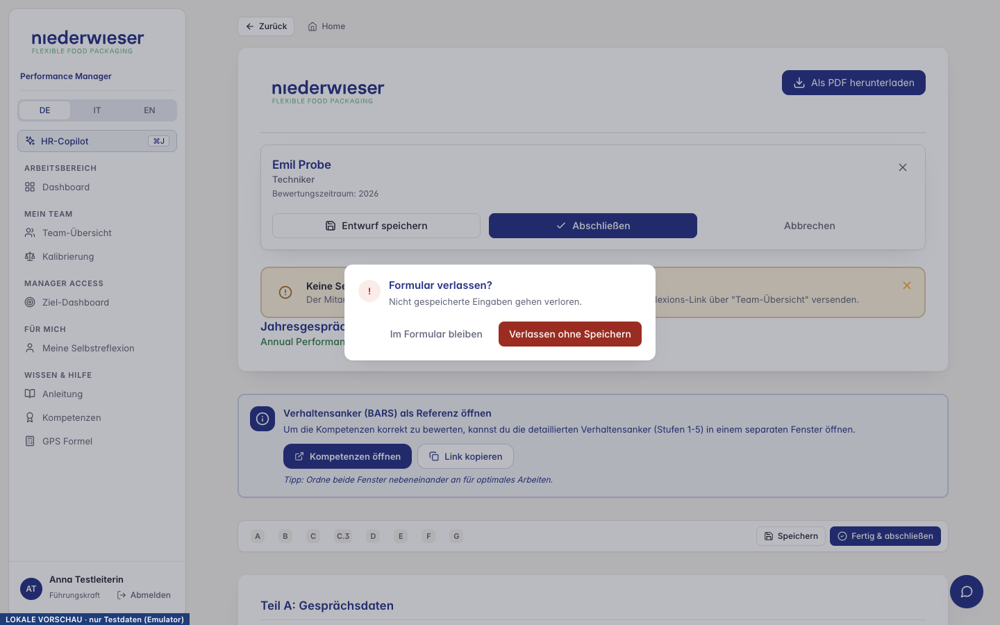
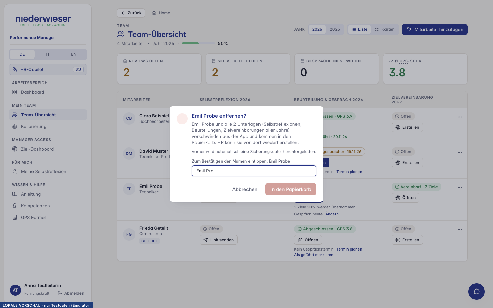
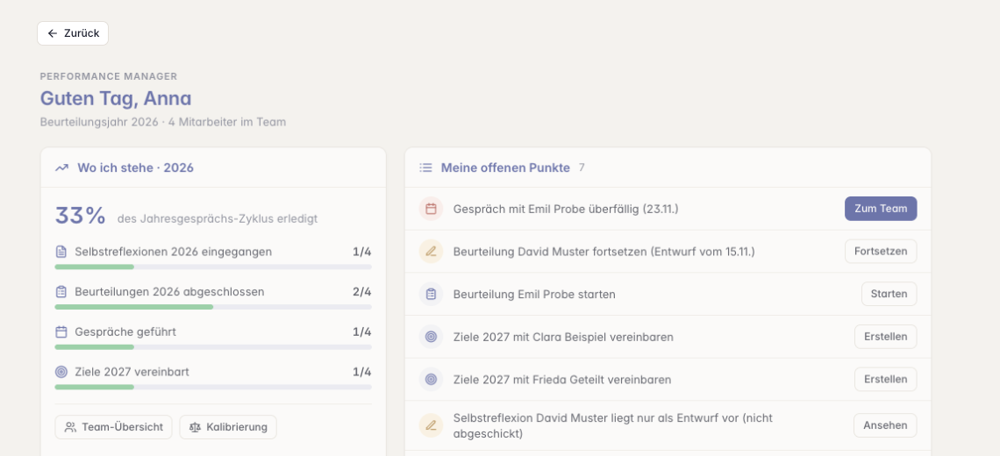
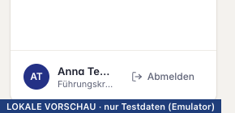
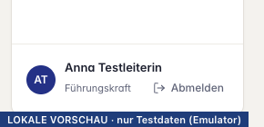
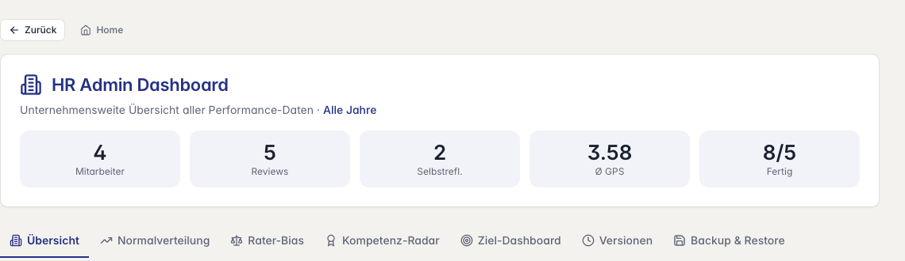
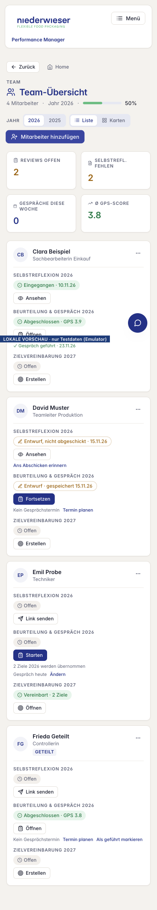

# Premium-UX: Übergabebericht

Stand: 23.11.2026 · Branch `feature/premium-ux` (von `feature/rollen-und-freigaben`, Commit `3cc3070`) ·
Draft-PR auf `feature/rollen-und-freigaben`

## Kurzfassung

Dieser Stand ist **ein erster, abgeschlossener Teil**, nicht die ganze Premium-Runde. Erledigt sind die Punkte, die
ein falsches Bild erzeugten oder den Ablauf am stärksten störten: der einheitliche Dialog statt Browser-Fenstern,
der falsche „Überfällig“-Alarm, die Scroll-Position beim Seitenwechsel, Rückmeldungen mit „Rückgängig“ und die
Team-Übersicht auf dem Handy. Offen sind das Glossar, die IT/EN-Texte und alles, was deine Freigabe braucht.

| Prüfung | Ausgangslage | Jetzt |
|---|---|---|
| Automatische Tests (`npm test`) | 57 / 57 grün | **70 / 70 grün** (13 neue in `tests/e2e/premium.spec.mjs`) |
| Dieselben Tests unter den eingespielten Firestore-Regeln (`npm run rules:vorschlag`) | 57 / 57 grün | **70 / 70 grün** |
| Schutzbereich (`node tests/protected/fingerprint.mjs`) | unverändert | **unverändert**, Baseline nicht angefasst |
| Konsolenfehler in den getesteten Abläufen | 0 | 0 |
| Browser-Fenster (`confirm`/`prompt`/`alert`) | 33 Stellen | 2 Stellen, beide im Schutzbereich |
| Bewertungssystem (Teile, Skalen, Formeln, Pflichtfelder) | – | unverändert |

Getestet wurde ausschließlich in der lokalen Vorschau mit dem Emulator und Testdaten. Nichts ist gemergt, nichts
liegt auf `main`.

## Was geändert wurde

### 1. Einheitlicher Dialog statt Browser-Fenstern (A3 aus §11)

Vorher: graue Systemfenster mit „OK / Abbrechen“, die eigentliche Aktion stand nur im Text
(„OK = trotzdem abschließen · Abbrechen = weiter bearbeiten“). Sie lassen sich nicht fotografieren, deshalb gibt es
hier nur Nachher-Bilder.

Jetzt: ein Dialog im n.Org-Stil mit Titel, Erklärung, Liste der offenen Punkte und klar beschrifteten Knöpfen.

| | |
|---|---|
| Abschluss-Prüfung |  |
| Formular verlassen |  |
| Mitarbeiter entfernen |  |

- Bei Aktionen, die etwas verlieren oder löschen, ist der Knopf rot und der Fokus liegt auf dem sicheren Knopf.
  Enter löscht nie versehentlich.
- Beim Entfernen eines Mitarbeiters wird „In den Papierkorb“ erst aktiv, wenn der Name stimmt. Die doppelte
  Rückfrage davor entfällt.
- Esc und ein Klick neben den Dialog brechen ab, Enter im Eingabefeld bestätigt, der Fokus kehrt zum Auslöser zurück.
- 30 Rückfragen sind umgestellt. Die Logik dahinter bekommt wie bisher Ja/Nein oder die Eingabe, kein Datenzugriff
  ist geändert.
- Auf Italienisch und Englisch nennt der Dialog beim Entfernen jetzt den Papierkorb (vorher „endgültig löschen“).
- **Bewusst nicht umgestellt** (Schutzbereich): die Namensabfrage bei der ersten Anmeldung (`LoginView.handleSubmit`)
  und das HR-Werkzeug `repairManagerIds`.

### 2. Gespräch von heute ist nicht mehr „überfällig“

Vorher galt ein Termin mit Datum heute sofort als überfällig, weil Mitternacht mit der aktuellen Uhrzeit verglichen
wurde. Wer einen Entwurf speicherte, sah direkt danach einen roten Alarm ganz oben im Dashboard.

| Vorher | Nachher |
|---|---|
|  |  |
|  |  |

Überfällig ist ein Gespräch jetzt ab dem Folgetag, am Tag selbst steht „Gespräch heute“. Das betrifft nur die
Anzeige (Dashboard, Status-Matrix, Karten, Kennzahl), gespeichert wird nichts anders.

### 3. Jede Seite beginnt oben

Vorher behielt der Inhaltsbereich beim Seitenwechsel die Scroll-Position der vorigen Seite. Eine Selbstreflexion
öffnete sich mitten im Bogen.

| Vorher | Nachher |
|---|---|
|  |  |

### 4. Rückmeldungen, die man versteht, mit „Rückgängig“


- Gespräch oder Zielgespräch als geführt markieren: Rückmeldung mit „Rückgängig“ (8 Sekunden). Rückgängig ruft
  denselben Umschalter auf wie ein zweiter Klick, es gibt keinen neuen Datenzugriff.
- Schlägt das Speichern eines Hakens fehl, erscheint jetzt „Speichern fehlgeschlagen“. Vorher passierte nichts.
- Nach dem Speichern eines Bogens: „Beurteilung für Emil Probe abgeschlossen“ statt
  „Bewertung abgeschlossen gespeichert!“.

### 5. Feinschliff

| Vorher | Nachher |
|---|---|
|  |  |
|  |  |

- Nutzerkarte: Name in voller Breite, Rolle und Abmelden darunter.
- HR-Dashboard: Reiter durchgehend mit Icons statt gemischt mit Emojis.
- Bogenkopf: Icons statt Emojis, „Entwurf speichern“ heißt auch in der Zielvereinbarung so.
- Mit Schalter `shareWithEmployee`: Hinweis „Seit dem Teilen geändert“ mit „Erneut teilen“ (F3 aus §11).

### 6. Team-Übersicht auf dem Handy (U6)

Vorher war die Status-Matrix auf dem Handy eine Tabelle, die breiter ist als der Bildschirm. Beurteilung,
Zielvereinbarung und das ⋯-Menü lagen unsichtbar rechts. Jetzt zeigt die App unter 768 px je Mitarbeiter eine Karte
mit denselben drei Schritten und denselben Aktionen untereinander. Ab 768 px bleibt die Tabelle wie bisher.

| Vorher (390 px) | Nachher (390 px) |
|---|---|
|  |  |

Dabei zwei Fehler behoben, die nicht nur das Handy betrafen:

- **⋯-Menü ragte unten aus dem Bildschirm.** In unteren Zeilen war der letzte Eintrag („Entfernen“) abgeschnitten und
  nicht erreichbar, weil Scrollen das Menü schließt. Das Menü wird jetzt nach dem Öffnen gemessen und ganz in den
  sichtbaren Bereich geschoben, auch am Desktop.
- **Toast auf dem Handy gequetscht.** Sein Behälter begann bei 50 % der Breite, der Text brach nach jedem Wort um.
  Jetzt nutzt er die Bildschirmbreite und sitzt über dem runden HR-Copilot-Knopf.


## Prüfungen

```bash
node tests/protected/fingerprint.mjs
```

```bash
cd tests && npm test
```

```bash
cd tests && npm run rules:vorschlag
```

Ergebnis des letzten Laufs vor dem Push (23.11.2026): Schutzbereich unverändert, `npm test` 70 / 70 grün,
`npm run rules:vorschlag` 70 / 70 grün.

Die bestehenden Tests mussten für den Dialog nicht umgeschrieben werden: `tests/e2e/fixtures.mjs` meldet jeden
App-Dialog über dieselben `page.on('dialog')`-Listener wie ein Browser-Fenster. Ein Test wurde inhaltlich angepasst:
Beim Entfernen mit falschem Namen bleibt der Knopf gesperrt, die nachträgliche Meldung „Name stimmt nicht überein“
gibt es an dieser Stelle nicht mehr.

Vorher-Nachher-Bilder neu erzeugen (Vorschau muss laufen):

```bash
cd tests && node shots-premium.mjs <pfad-zur-alten-index.html>
```

## Was offen bleibt (ohne Schutzbereich)

| # | Punkt | Warum noch offen |
|---|---|---|
| U4 | Knopf-Beschriftungen in der Abschnittsleiste und im Mitarbeiterbogen vereinheitlichen | braucht Anpassungen an mehreren Tests, eigener Schritt |
| U10 | Erklärungen für GPS, WAS, WIE, BARS beim Darüberfahren (A5) | nicht begonnen |
| U11 | „Selbstreflexion ansehen“: ein Zurück, dazu „Beurteilung starten“ | nicht begonnen |
| U12 | Erklärblöcke im Dashboard für Führungskräfte mit Team einklappen | nicht begonnen |
| U14 | rund 220 Textstellen nur DE/EN, Italienisch zeigt dort Englisch (A6) | groß, eigene Runde |

Nicht vollständig durchgespielt habe ich: PDF-Erzeugung im Browser, Kalibrierung und Ziel-Dashboard im Detail,
Salary Review und den Mitarbeiterbogen bis zum Abschicken von Hand. Diese Abläufe sind durch die automatischen
Tests abgedeckt, aber nicht mit eigenen Augen auf Feinschliff geprüft.

Die Handy-Ansicht ist bei 390 px automatisch getestet und auf Bildschirmfotos geprüft, **aber nicht auf einem echten
Handy** (Fingerbedienung, Tastatur, Safari). Auf dem Handy umgestellt ist nur die Team-Übersicht; die Bögen,
das HR-Dashboard und die Kartenansicht habe ich dort nicht überarbeitet.

## Was du entscheiden oder freigeben musst

Nichts davon ist umgesetzt. Details in [BEFUNDE.md](BEFUNDE.md), Abschnitt B.

1. **S1 „Speichern“ wirft aus dem Bogen.** Zwischenspeichern führt zurück in die Team-Übersicht. Vorschlag: im
   Bogen bleiben und „Gespeichert · 14:32“ zeigen. Berührt den Ablauf nach dem Speichern.
2. **S7 Geteilte Mitarbeiter.** Eine Führungskraft, mit der ein Mitarbeiter geteilt ist, kann unter den
   eingespielten Regeln weder „Gespräch geführt“ setzen noch einen Termin planen. Bisher schlug das still fehl,
   jetzt kommt eine Fehlermeldung. Entscheidung: Regeln für genau diese Felder öffnen oder die Aktionen bei
   geteilten Mitarbeitern sperren und den Grund nennen.
3. **S2 Ø GPS-Score.** Ein frischer Entwurf mit Vorgabewerten zieht den Team-Durchschnitt (im Test von 3,8 auf 3,2).
   Vorschlag: nur abgeschlossene Beurteilungen zählen.
4. **S3 / S8 HR-Kennzahlen bei „Alle Jahre“.** „150 % Reviews“ und „8/5 Fertig“.
5. **S4 „Passwort vergessen?“** in der Anmeldung (neuer Auth-Aufruf).
6. **S5 „Rückgängig“ für Termin löschen und E-Mail ergänzen** (bräuchte einen neuen Schreibzugriff).
7. **S6 HR-Reiter.** Unter Papierkorb, Benutzer, Backup und Versionen steht weiter die ganze Beurteilungsliste samt
   „GPS für alle neu berechnen“.
8. **M5** Bonus- und GPS-Anzeige im Mitarbeiterbogen (bekannt).

## Hinweise zur Umgebung

- Java (OpenJDK 27) wurde mit deiner Freigabe über Homebrew installiert, ohne Systemänderung. Für die Befehle oben
  muss es im Pfad liegen: `export PATH="/opt/homebrew/opt/openjdk/bin:$PATH"`.
- `tests/package-lock.json` ändert sich bei `npm install` mit npm 11. Die Änderung ist **nicht** eingecheckt.
- Im alten Ordner `~/performance-app` liegt ein nicht mehr benutzter Klon `niederwieser-performance-guide/`
  (ohne Commits, nichts gepusht). Er kann gelöscht werden.
