# Premium-UX: Übergabebericht

Stand: 23.11.2026 · Branch `feature/premium-ux` (von `feature/rollen-und-freigaben`, Commit `3cc3070`) ·
Draft-PR auf `feature/rollen-und-freigaben`

## Kurzfassung

Dieser Stand ist **ein erster, abgeschlossener Teil**, nicht die ganze Premium-Runde. Erledigt sind die Punkte, die
ein falsches Bild erzeugten oder den Ablauf am stärksten störten: der einheitliche Dialog statt Browser-Fenstern,
der falsche „Überfällig“-Alarm, die Scroll-Position beim Seitenwechsel, Rückmeldungen mit „Rückgängig“ und die
Team-Übersicht auf dem Handy, einheitliche Knopf-Beschriftungen, der nächste Schritt nach dem Lesen einer
Selbstreflexion, das Glossar und ein kompaktes Dashboard. Offen sind die IT/EN-Texte und alles, was deine
Freigabe braucht.

| Prüfung | Ausgangslage | Jetzt |
|---|---|---|
| Automatische Tests (`npm test`) | 57 / 57 grün | **87 / 87 grün** (30 neue in `tests/e2e/premium.spec.mjs`) |
| Dieselben Tests unter den eingespielten Firestore-Regeln (`npm run rules:vorschlag`) | 57 / 57 grün | **87 / 87 grün** |
| Schutzbereich (`node tests/protected/fingerprint.mjs`) | unverändert | **unverändert**, Baseline nicht angefasst |
| Konsolenfehler in den getesteten Abläufen | 0 | 0 |
| Browser-Fenster (`confirm`/`prompt`/`alert`) | 33 Stellen | 2 Stellen, beide im Schutzbereich |
| Emojis und Symbolzeichen in der Oberfläche | 501 Zeilen | 16 Zeilen, alle im Schutzbereich |
| Bewertungssystem (Teile, Skalen, Formeln, Pflichtfelder) | – | unverändert |

Getestet wurde ausschließlich in der lokalen Vorschau mit dem Emulator und Testdaten. Nichts ist gemergt, nichts
liegt auf `main`.

## Was geändert wurde

### 1. Einheitlicher Dialog statt Browser-Fenstern (A3 aus §11)

Vorher: graue Systemfenster mit „OK / Abbrechen“, die eigentliche Aktion stand nur im Text
(„OK = trotzdem abschließen · Abbrechen = weiter bearbeiten“). Sie lassen sich nicht fotografieren, deshalb gibt es
hier nur Nachher-Bilder.

Jetzt: ein Dialog im n.Org-Stil mit Titel, Erklärung, Liste der offenen Punkte und klar beschrifteten Knöpfen.

| | |
|---|---|
| Abschluss-Prüfung | 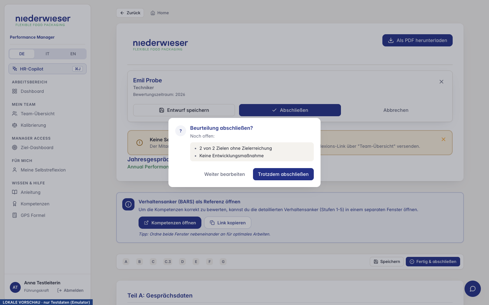 |
| Formular verlassen |  |
| Mitarbeiter entfernen |  |

- Bei Aktionen, die etwas verlieren oder löschen, ist der Knopf rot und der Fokus liegt auf dem sicheren Knopf.
  Enter löscht nie versehentlich.
- Beim Entfernen eines Mitarbeiters wird „In den Papierkorb“ erst aktiv, wenn der Name stimmt. Die doppelte
  Rückfrage davor entfällt.
- Esc und ein Klick neben den Dialog brechen ab, Enter im Eingabefeld bestätigt, der Fokus kehrt zum Auslöser zurück.
- 30 Rückfragen sind umgestellt. Die Logik dahinter bekommt wie bisher Ja/Nein oder die Eingabe, kein Datenzugriff
  ist geändert.
- Auf Italienisch und Englisch nennt der Dialog beim Entfernen jetzt den Papierkorb (vorher „endgültig löschen“).
- **Bewusst nicht umgestellt** (Schutzbereich): die Namensabfrage bei der ersten Anmeldung (`LoginView.handleSubmit`)
  und das HR-Werkzeug `repairManagerIds`.

### 2. Gespräch von heute ist nicht mehr „überfällig“

Vorher galt ein Termin mit Datum heute sofort als überfällig, weil Mitternacht mit der aktuellen Uhrzeit verglichen
wurde. Wer einen Entwurf speicherte, sah direkt danach einen roten Alarm ganz oben im Dashboard.

| Vorher | Nachher |
|---|---|
|  | 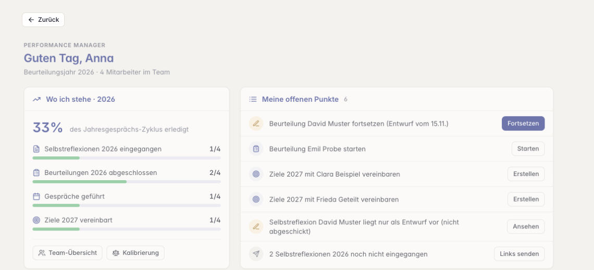 |
| 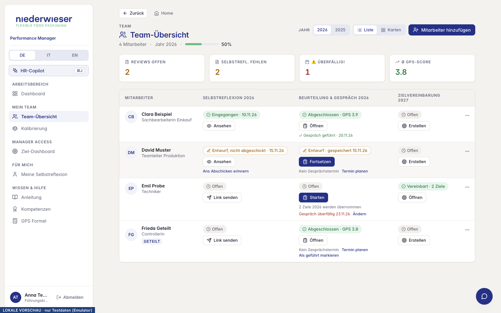 | 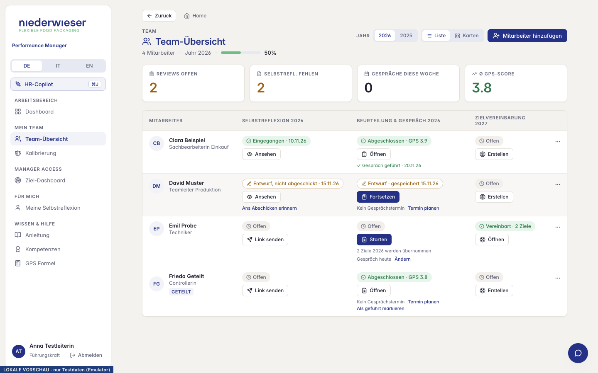 |

Überfällig ist ein Gespräch jetzt ab dem Folgetag, am Tag selbst steht „Gespräch heute“. Das betrifft nur die
Anzeige (Dashboard, Status-Matrix, Karten, Kennzahl), gespeichert wird nichts anders.

### 3. Jede Seite beginnt oben

Vorher behielt der Inhaltsbereich beim Seitenwechsel die Scroll-Position der vorigen Seite. Eine Selbstreflexion
öffnete sich mitten im Bogen.

| Vorher | Nachher |
|---|---|
| 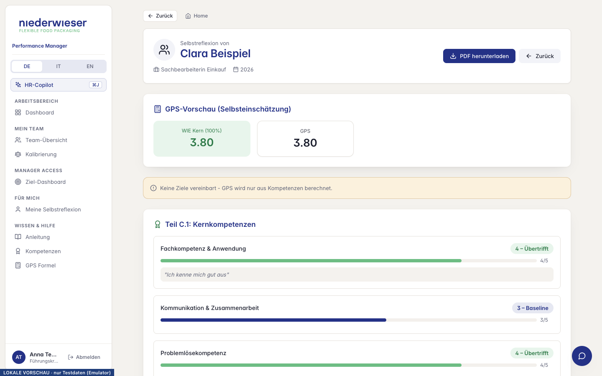 | 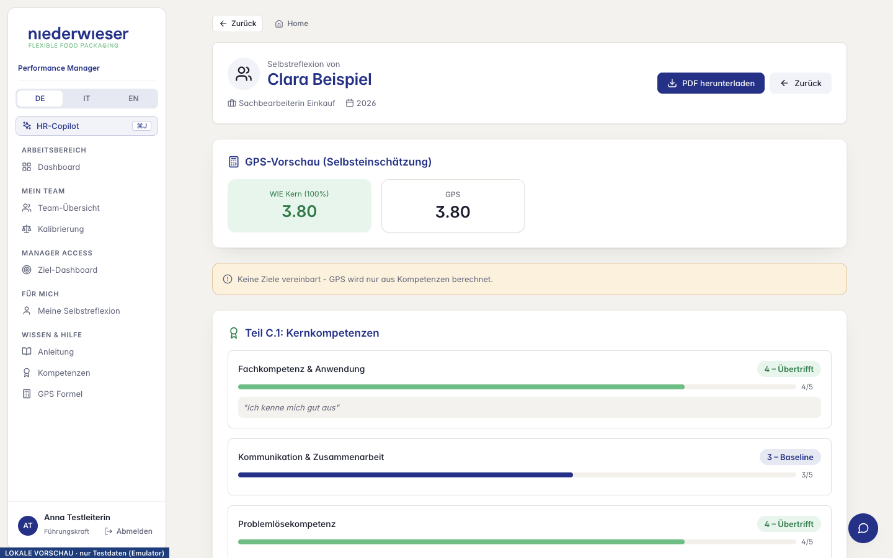 |

### 4. Rückmeldungen, die man versteht, mit „Rückgängig“

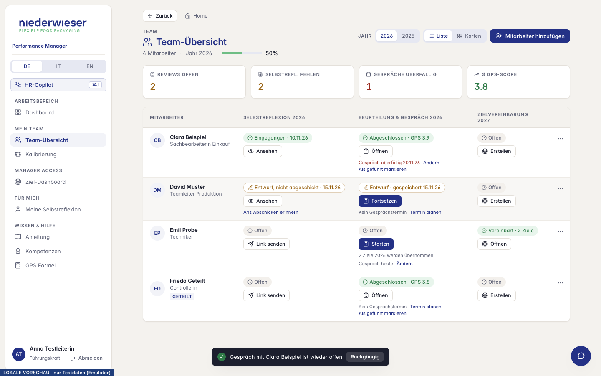

- Gespräch oder Zielgespräch als geführt markieren: Rückmeldung mit „Rückgängig“ (8 Sekunden). Rückgängig ruft
  denselben Umschalter auf wie ein zweiter Klick, es gibt keinen neuen Datenzugriff.
- Schlägt das Speichern eines Hakens fehl, erscheint jetzt „Speichern fehlgeschlagen“. Vorher passierte nichts.
- Nach dem Speichern eines Bogens: „Beurteilung für Emil Probe abgeschlossen“ statt
  „Bewertung abgeschlossen gespeichert!“.

### 5. Feinschliff

| Vorher | Nachher |
|---|---|
|  |  |
| 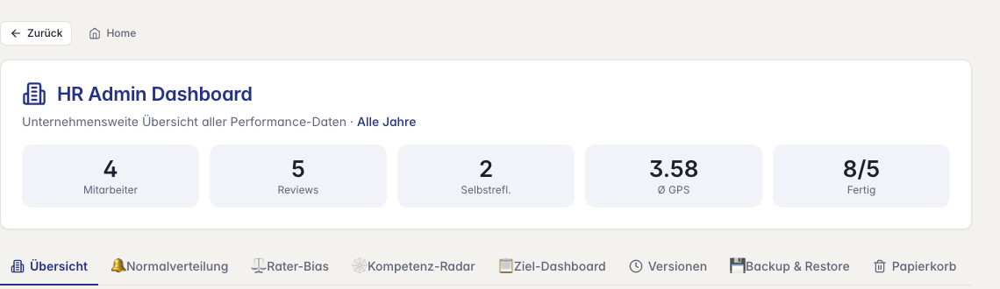 |  |

- Nutzerkarte: Name in voller Breite, Rolle und Abmelden darunter.
- HR-Dashboard: Reiter durchgehend mit Icons statt gemischt mit Emojis.
- Bogenkopf: Icons statt Emojis, „Entwurf speichern“ heißt auch in der Zielvereinbarung so.
- Mit Schalter `shareWithEmployee`: Hinweis „Seit dem Teilen geändert“ mit „Erneut teilen“ (F3 aus §11).

### 6. Team-Übersicht auf dem Handy (U6)

Vorher war die Status-Matrix auf dem Handy eine Tabelle, die breiter ist als der Bildschirm. Beurteilung,
Zielvereinbarung und das ⋯-Menü lagen unsichtbar rechts. Jetzt zeigt die App unter 768 px je Mitarbeiter eine Karte
mit denselben drei Schritten und denselben Aktionen untereinander. Ab 768 px bleibt die Tabelle wie bisher.

| Vorher (390 px) | Nachher (390 px) |
|---|---|
| 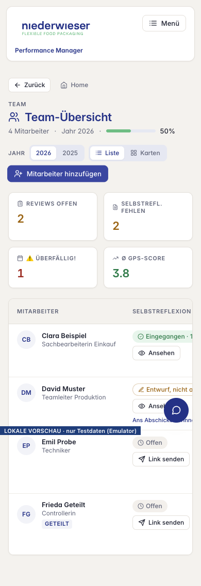 |  |

Dabei zwei Fehler behoben, die nicht nur das Handy betrafen:

- **⋯-Menü ragte unten aus dem Bildschirm.** In unteren Zeilen war der letzte Eintrag („Entfernen“) abgeschnitten und
  nicht erreichbar, weil Scrollen das Menü schließt. Das Menü wird jetzt nach dem Öffnen gemessen und ganz in den
  sichtbaren Bereich geschoben, auch am Desktop.
- **Toast auf dem Handy gequetscht.** Sein Behälter begann bei 50 % der Breite, der Text brach nach jedem Wort um.
  Jetzt nutzt er die Bildschirmbreite und sitzt über dem runden HR-Copilot-Knopf.

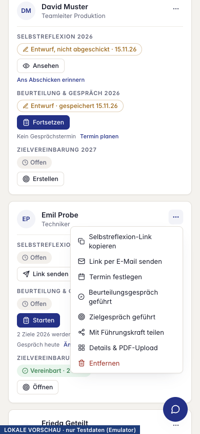

### 7. Je Aktion ein Wort (U4)

Dieselbe Aktion hieß in einem Bogen bis zu dreimal anders. Jetzt gilt:

| Aktion | Vorher | Jetzt |
|---|---|---|
| Entwurf sichern | „Entwurf speichern“ / „Speichern“ / „Als Entwurf“ / „Als Entwurf speichern“ | **Entwurf speichern** |
| Führungskraft schließt ab | „Abschließen“ / „Fertig & abschließen“ | **Abschließen** |
| Mitarbeiter schickt ab | „Abschließen & Senden“ / „Fertig & senden“ / „Selbstreflexion abschicken“ | **Selbstreflexion abschicken** (in der schmalen Leiste kurz „Abschicken“) |

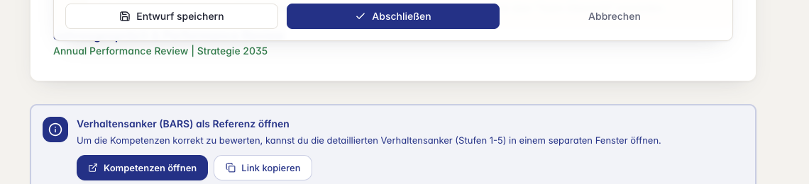

Die Hinweise, die den Knopf beim Namen nennen, ziehen mit: die Willkommensseite des Mitarbeiter-Links, der Hinweis
im Bogen und **die Einladungs-E-Mail der Führungskraft** (dort stand „Klicke am Ende auf ‚Absenden‘“, einen Knopf
mit diesem Namen gab es nie). Bitte einmal bewusst ansehen, weil es ein Text ist, der die App verlässt.

Nicht angefasst sind die Texte des HR-Copilot. Dort steht an einer Stelle noch „Als Entwurf speichern“.

### 8. Selbstreflexion ansehen: nächster Schritt (U11)

Vorher gab es in der Ansicht drei „Zurück“-Knöpfe und keinen Weg weiter. Jetzt steht oben und am Ende der nächste
Schritt für dasselbe Beurteilungsjahr: „Beurteilung starten“, „Beurteilung fortsetzen“ oder, wenn sie schon
abgeschlossen ist, „Beurteilung öffnen“ als Nebenaktion. „Zurück“ oben und „Zurück zum Team“ unten bleiben.

| Vorher | Nachher |
|---|---|
| 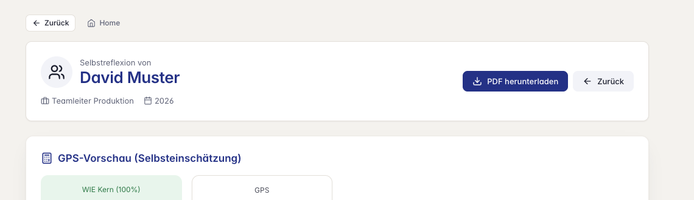 | 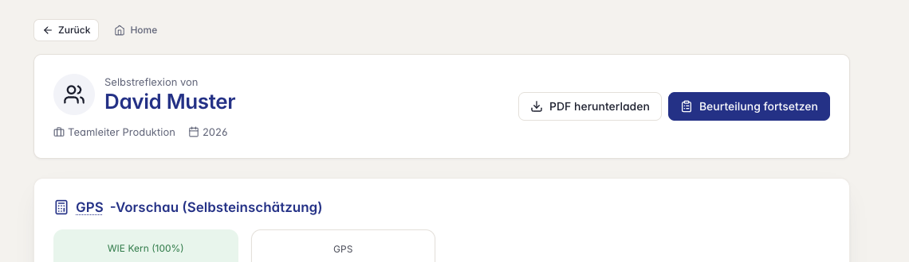 |

Der Knopf ruft dieselbe Funktion auf wie „Starten“/„Fortsetzen“ in der Team-Übersicht. Er erscheint nur bei eigenen
Teammitgliedern; HR und der Weg aus einer Beurteilung heraus („← Beurteilung“) sind unverändert.

### 9. Glossar: GPS, WAS, WIE, BARS erklären sich selbst (U10, A5 aus §11)

Die vier Fachbegriffe sind gepunktet unterstrichen. Beim Darüberfahren, Antippen oder per Tab erscheint eine kurze
Erklärung, Esc blendet sie aus. Für Screenreader hängt die Beschreibung dauerhaft am Begriff.

| An der Kennzahl | Im Bogen |
|---|---|
| 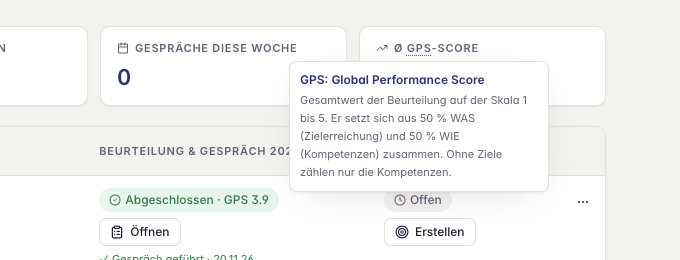 | 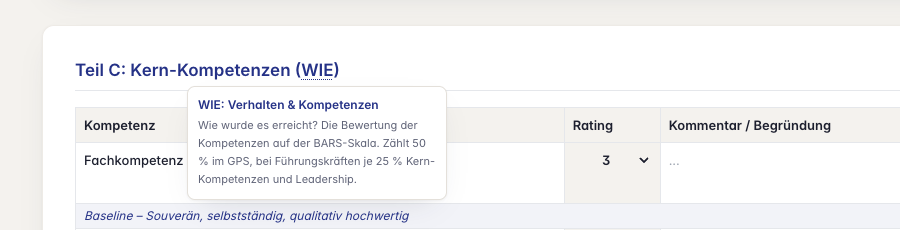 |

- **Wo:** Kennzahl „Ø GPS-Score“ in der Team-Übersicht, die Überschriften von Teil B, C und C.3 in Beurteilung und
  Selbstreflexion, „BARS“ in der Zieltabelle, „GPS-Vorschau“ in „Selbstreflexion ansehen“ und die Spaltenköpfe
  GPS, WAS, WIE der HR-Tabelle. Bewusst nicht an jedem Chip, damit die Seite ruhig bleibt.
- **Wortlaut der Überschriften unverändert.** Die Abschnittsleiste liest sie weiter wie bisher.
- **Sprachen:** auf Italienisch COSA/COME, auf Englisch WHAT/HOW, jeweils mit eigener Erklärung.
- **Inhalt:** Die vier Texte fassen zusammen, was die App im Dashboard und unter „GPS Formel“ schon sagt
  (GPS = 50 % WAS + 50 % WIE, bei Führungskräften je 25 % Kern-Kompetenzen und Leadership, BARS = fünf Stufen mit
  Verhaltensankern). **Bitte einmal fachlich gegenlesen**, sie stehen in `index.html` unter `NW_GLOSSARY`.

### 10. Dashboard: Grundlagen einklappbar (U12)

Für Führungskräfte mit Team folgten unter den offenen Punkten rund 2 200 px Erklärblöcke (Willkommen, Werte,
Performance Kompass, BARS, Jahreszyklus), die es unter „Anleitung“ und „GPS Formel“ ebenfalls gibt. Sie liegen jetzt
in einem aufklappbaren Bereich „Grundlagen: Werte, GPS und Jahreszyklus“, nach demselben Muster wie der
Schnellstart-Guide: **offen für neue Nutzer** (nicht angemeldet oder noch kein Team), **eingeklappt für
Führungskräfte mit Team**. Nichts ist entfernt, der Inhalt ist unverändert. Der Jahreskalender bleibt sichtbar.

| Vorher (3 119 px hoch) | Nachher (861 px hoch) |
|---|---|
| 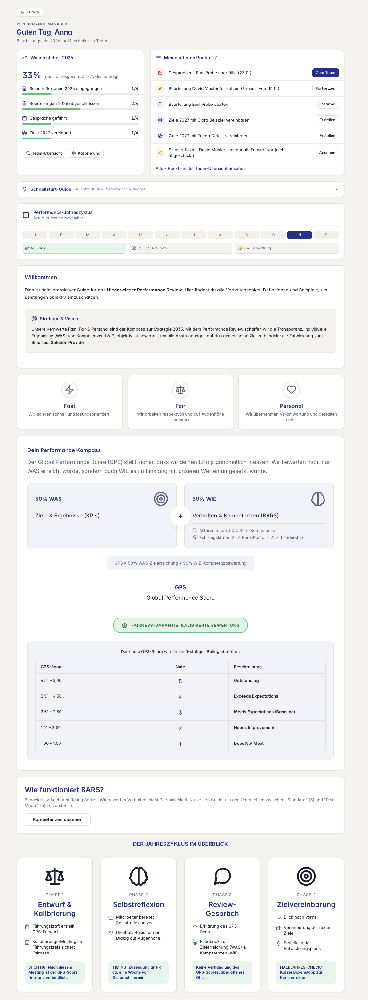 | 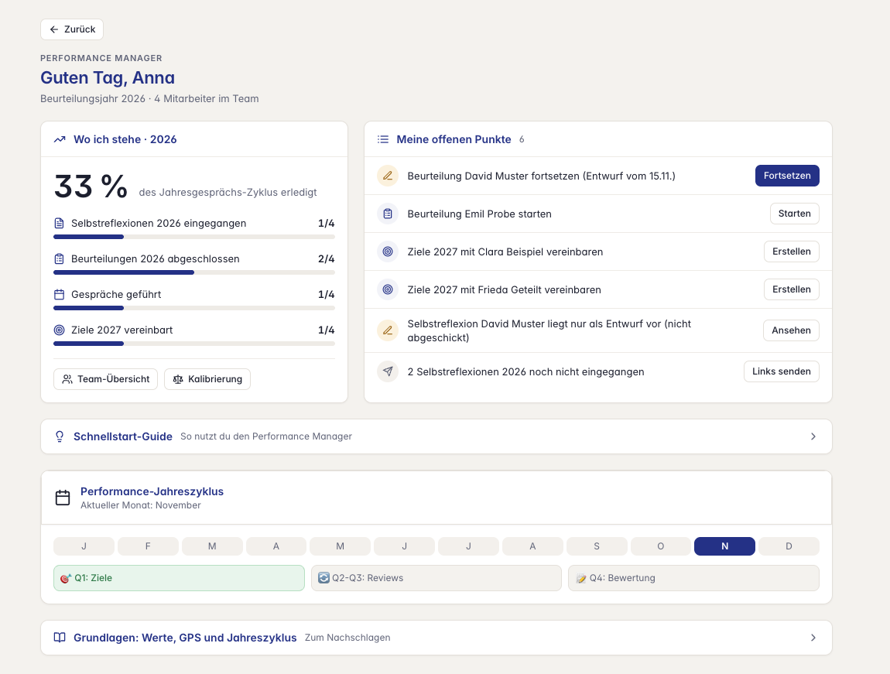 |

### 11. n.Org Design System 2.0, Stufe 1 (Fundament)

Grundlage ist das Übergabepaket „Design System erstellen“ (`design-system.md` Teil II §9–§16, `implementation/`,
Prototyp `Application 2.0.dc.html`). 2.0 baut auf dem Stand auf, den die App schon hatte: Farben, Schrift, Radien
und Schatten sind unverändert. Neu sind Bewegungs-Tokens, Regeln für Handy und Touch, Kennzahl-Schrift und Muster.

**Umgesetzt in Stufe 1**

| Bereich | Was |
|---|---|
| Tokens | vollständiger 2.0-Satz in der eingebetteten Tailwind-Konfiguration: `xs`-Breakpoint, `text-touch` / `3xl` / `4xl`, `chart-*`, `heat-*`, `warn-line`, `danger-line`, `rounded-ctl`, `shadow-drawer`, Dauer- und Easing-Tokens, alle neuen Keyframes, Varianten `coarse:` / `fine:` |
| Stile | Typografie-Rollen `.t-*`, `.skeleton` mit Schimmer, `.table-scroll`, `.disclose`, `.line-draw`, Feldfehler `aria-invalid`, Eingaben 16 px auf Touch-Geräten |
| Migration §14.2 | `rounded-[7px]` → `rounded-ctl` (13 Stellen), Lade-Platzhalter `animate-pulse` → `.skeleton` |
| Dialog | unter 640 px als Bottom-Sheet von unten (volle Breite, oben gerundet, Knöpfe 44 px, Rand für die Geräte-Unterkante), Abgang 200 ms |
| Akkordeon | Schnellstart-Guide und Grundlagen im Dashboard gleiten über `.disclose` auf (280 ms), Chevron dreht 90° |
| Kennzahlen | Wert in `t-kpi` (32/38, mobil 26/32), große Dashboard-Zahl in `t-display`, Fortschritt nach „Progress“ (Spur `line-2`, Füllung `chart-1`, 400 ms) |
| Seitenwechsel | `view-in` (Deckkraft + 4 px, 200 ms) statt des bisherigen Auftritts, kein seitliches Schieben |
| Touch | Knöpfe 36/40/44 px, Icon-Knöpfe 44 × 44 px, sobald das Gerät ein Touch-Gerät ist |
| Glossar | Fließtext 12 px (11 px nur für Versalien und Ziffern) |


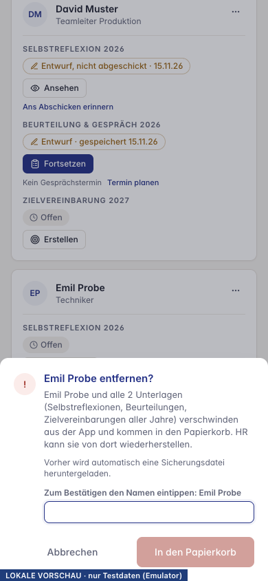

**Bewusste Abweichungen (aus meiner Sicht besser, bitte entscheiden)**

- Bei Dialogen, die etwas löschen oder verwerfen, liegt der Startfokus auf „Abbrechen“. Laut Paket löst Enter die
  Hauptaktion aus; hier würde Enter sonst versehentlich löschen.
- Eingeklappter Akkordeon-Inhalt ist unsichtbar geschaltet, damit er nicht per Tab erreichbar ist und nicht
  vorgelesen wird. Im Paket bleibt er erreichbar.
- Platzhalter in Feldern bleiben `ink-60` statt `ink-40`, weil die Barrierefreiheits-Prüfung `ink-40` bemängelt.
- Kennzahl-Karten sind ohne Verlaufslinie und Veränderung gegenüber der Vorperiode, weil es in dieser App dafür
  keine Zeitreihen gibt. Sie sind deshalb flacher als die 132 px des Pakets.

**Noch nicht umgesetzt (Stufen 2 bis 4, Reihenfolge bitte bestätigen)**

| Stufe | Inhalt | Umfang |
|---|---|---|
| 2 Shell | **erledigt**, siehe Abschnitt 12 | |
| 3 Muster | `transition-all` an 74 Stellen durch gezielte Übergänge ersetzen, Speichern-Knopf mit Zustandsfolge und gezeichnetem Haken, Feldfehler mit einmaligem Schütteln, Reiter mit gleitendem Strich, Tabellen-Strategien (HR-Tabelle mit fester erster Spalte), Bögen und HR-Dashboard auf dem Handy | mittel bis groß |
| 4 Charts | HR-Dashboard (Verteilung, Rater-Bias, Radar) auf `chart-*`, `ChartFrame` mit vier Zuständen, Titel als Aussage, Zahlenformat nach §10.3 | mittel |

Den Prototyp `Application 2.0.dc.html` habe ich für Stufe 1 **nicht Zeile für Zeile** gelesen, sondern die
Spezifikation (Teil II vollständig), die Konfiguration, die Stile und die Bausteine. Für Stufe 2 lese ich die Shell
des Prototyps vollständig, bevor ich baue.

Das Paket liegt nicht im Repository. Ob es nach `docs/design-transfer-2.0/` soll, ist deine Entscheidung
(das Repository ist öffentlich, das Paket enthält die Firmenlogos).

### 12. n.Org Design System 2.0, Stufe 2: Übernahme in der Fläche

Auslöser war deine Rückmeldung nach dem ersten Test: nur leicht orientiert, Emojis noch enthalten. Vorgehen: erst
messen, dann je Bereich eine feste Regel, automatisch anwenden, Schutzbereich und Tests prüfen, eigener Commit.

| Bereich | Vorher | Nachher | Was |
|---|---|---|---|
| Emojis und Symbolzeichen | 501 Zeilen | 16 (Schutzbereich) | 453 Vor-/Nachsätze entfernt, 90 allein stehende → Icons aus dem Lucide-Satz, Ampel-Emojis → Punkt-Baustein, Toast und Dialog mit gezeichneten Icons, Status als Chip mit Text |
| Shell | Karte oben, Menü klappt auf | drei Zustände nach §16.1 | Seitenleiste 256 px (einklappbar), schmale Leiste 84 px mit Overlay, Top-Leiste 56 px mit Schublade, Start-/Zurück-Pille, Konto-Popover, Sprach-Menü, Logos LmP 196 / LoP 112 |
| Pauschale Übergänge | 74 | 0 | gezielte Eigenschaften, Dauern als Tokens |
| Flächen mit Dialog-Radius | 295 | 19 (Dialoge, Leisten-Karte) | 10 px für Flächen |
| Schwebe-Schatten an ruhenden Flächen | 67 | 0 | `shadow-card` |
| Doppelte Rahmen / Weichzeichner | 38 / 26 | 0 / 0 | |
| Laufweiten außerhalb der Skala | 23 | 0 | |
| Knöpfe im Knopf-Set | 43 von 248 | 105 von 260 | 48 frei gestaltete umgestellt, dazu Shell und Dialoge |
| Pfeil- und Trennzeichen | 84 | 0 | „←“/„→“ an Knöpfen entfernt, „ • “ → „ · “ |

| Desktop | Tablet (Overlay) | Handy (Schublade) |
|---|---|---|
| 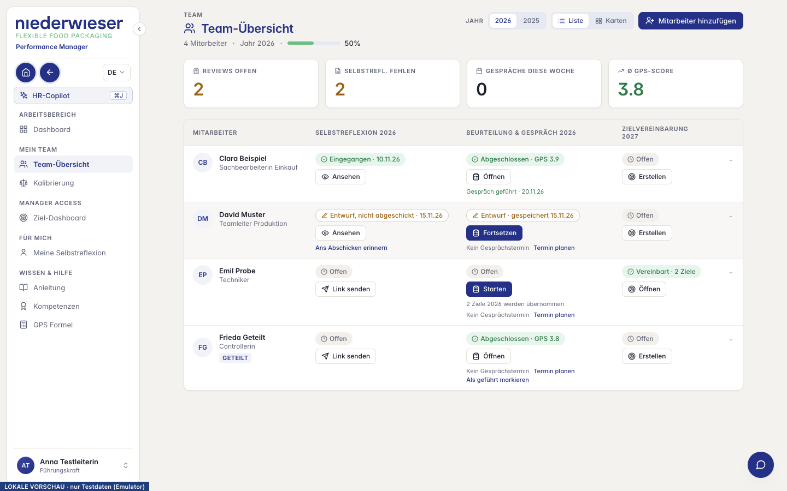 | 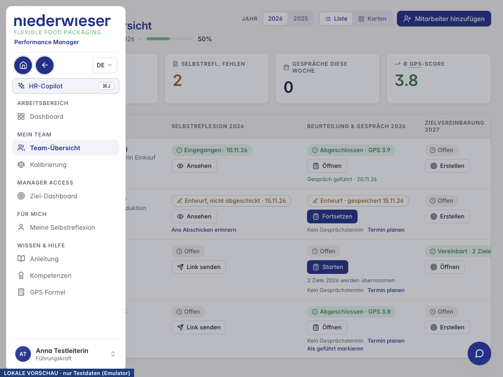 | 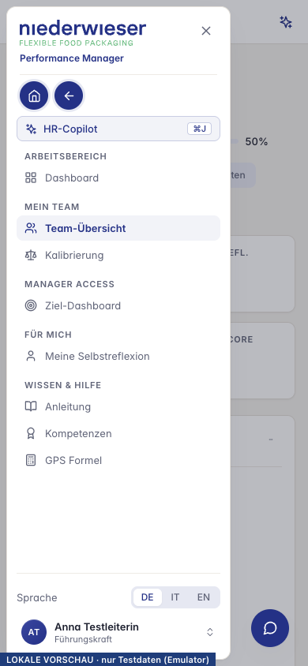 |

**Dabei gefunden und behoben:** Wo zwei widersprüchliche Klassen am selben Element standen (zwei Höhen, zwei
Seitenpolster), entschied die Reihenfolge, in der Tailwind die Klassen im Browser erzeugt. Mit der neuen Shell
kippte das: Das ⋯-Icon war gequetscht, die Sheet-Knöpfe zu niedrig. Knopf- und Dialog-Baustein setzen ihre Werte
jetzt eindeutig.

**Bewusste Abweichungen in dieser Stufe (bitte entscheiden)**

- **Zurück/Start auf dem Handy auch im Inhalt.** Laut Paket liegen die Pillen nur in der Leiste, also in der
  Schublade. Ohne sichtbaren Zurück-Knopf bräuchte man auf dem Handy zwei Tipps.
- **Assistent statt Suche.** Die App hat keine globale Suche; an ihrer Stelle steht der HR-Copilot.
- **Anmeldung bleibt in der Shell.** Laut Paket ist die Anmeldung eine eigene Seite ohne Leiste mit Logo 220 px über
  der Karte. Hier ist sie Teil der Team-Übersicht, weil nicht angemeldete Nutzer Dashboard und Anleitung sehen
  dürfen. Ein zweites Logo wäre gegen „ein Logo pro Ansicht“.
- **Kein Speicherstatus und kein Rückgängig-Verlauf im Leistenfuß.** Dafür gibt es in der App keine Grundlage
  (kein Autosave für Führungskräfte, kein Verlauf).
- **Grün und amber gefüllte Knöpfe sind jetzt blau** (eine Akzentfarbe). Dadurch gibt es Ansichten mit mehr als
  einer gefüllten Hauptaktion; welche davon Nebenaktion wird, ist eine inhaltliche Entscheidung je Ansicht.

**Noch nicht am Designsystem (gemessen, Stand dieses Commits)**

| Bereich | Stand | Warum offen |
|---|---|---|
| Knöpfe | 155 von 260 außerhalb des Knopf-Sets | zusammengesetzte Klassen (zustandsabhängig), Reiter, Listenzeilen, runde Icon-Knöpfe: nur einzeln umstellbar |
| Eingabefelder | 175 frei gestaltet | bereits einheitlich im Aussehen, aber nicht über den Feld-Baustein; Höhe 32/36 px und Touch-Größen fehlen |
| Schriftgröße 26 px | 106 Stellen | nur für Kennzahlen und Hero-Titel gedacht; jede Stelle braucht die passende Rolle (`t-kpi`, `t-section`, …) |
| Inline-Stile | 301 | Farben stammen aus der Palette, stehen aber als Wert im Code statt als Token |
| Deko-Kreise 64–96 px | 12 | Leerzustände nach dem Baustein (36 px) |
| Versalien ohne Overline-Baustein | 59 | |
| PDF-Vorlagen | 24 Zeilen mit Emojis | Aussehen der PDFs soll laut `PROTECTED.md` vorher gezeigt werden |
| Schutzbereich | 16 Zeilen mit Symbolzeichen | HR-Reparaturwerkzeug, Rückgabe der Vollständigkeits-Berechnung (Anzeige ist schon auf Icons umgestellt) |
| Muster | Speichern-Knopf mit Zustandsfolge, Feldfehler mit Schütteln, gleitende Reiter, Tabellen-Strategien, Bögen auf dem Handy | Stufe 3 |
| Charts im HR-Bereich | Farben aus der Palette, aber ohne `ChartFrame`, Zustände und Zahlenformat | Stufe 4 |

Die Messung lässt sich jederzeit wiederholen; die Regeln der Umstellung stehen in den Commit-Texten.

## Prüfungen

```bash
node tests/protected/fingerprint.mjs
```

```bash
cd tests && npm test
```

```bash
cd tests && npm run rules:vorschlag
```

Ergebnis des letzten Laufs vor dem Push (23.11.2026): Schutzbereich unverändert, `npm test` 87 / 87 grün,
`npm run rules:vorschlag` 87 / 87 grün.

Die bestehenden Tests mussten für den Dialog nicht umgeschrieben werden: `tests/e2e/fixtures.mjs` meldet jeden
App-Dialog über dieselben `page.on('dialog')`-Listener wie ein Browser-Fenster.

Angepasste bestehende Tests, jeweils mit Kommentar an der Stelle:

- Entfernen mit falschem Namen: Der Knopf bleibt gesperrt, die nachträgliche Meldung „Name stimmt nicht überein“
  gibt es dort nicht mehr.
- Vier Stellen nennen die neuen Knopfnamen (U4).
- Drei Stellen enthielten einen Rest aus der Zeit vor dem Dialog („falls noch ein Bestätigen-Knopf sichtbar ist,
  klicken“). Er traf nach U4 den gleichnamigen Knopf in der Leiste und ist entfernt; die Rückfrage beantwortet
  der Dialog-Listener.

Vorher-Nachher-Bilder neu erzeugen (Vorschau muss laufen):

```bash
cd tests && node shots-premium.mjs <pfad-zur-alten-index.html>
```

```bash
cd tests && node shots-glossar.mjs
```

## Was offen bleibt (ohne Schutzbereich)

| # | Punkt | Warum noch offen |
|---|---|---|
| U15 | Jahreskalender im Dashboard hebt fest „Q1: Ziele“ hervor, auch im November | beim Prüfen von U12 gefunden, reine Anzeige, noch nicht behoben |
| U14 | rund 220 Textstellen nur DE/EN, Italienisch zeigt dort Englisch (A6) | groß, eigene Runde |

Nicht vollständig durchgespielt habe ich: PDF-Erzeugung im Browser, Kalibrierung und Ziel-Dashboard im Detail,
Salary Review und den Mitarbeiterbogen bis zum Abschicken von Hand. Diese Abläufe sind durch die automatischen
Tests abgedeckt, aber nicht mit eigenen Augen auf Feinschliff geprüft.

Die Handy-Ansicht ist bei 390 px automatisch getestet und auf Bildschirmfotos geprüft, **aber nicht auf einem echten
Handy** (Fingerbedienung, Tastatur, Safari). Auf dem Handy umgestellt ist nur die Team-Übersicht; die Bögen,
das HR-Dashboard und die Kartenansicht habe ich dort nicht überarbeitet.

## Was du entscheiden oder freigeben musst

Nichts davon ist umgesetzt. Details in [BEFUNDE.md](BEFUNDE.md), Abschnitt B.

1. **S1 „Speichern“ wirft aus dem Bogen.** Zwischenspeichern führt zurück in die Team-Übersicht. Vorschlag: im
   Bogen bleiben und „Gespeichert · 14:32“ zeigen. Berührt den Ablauf nach dem Speichern.
2. **S7 Geteilte Mitarbeiter.** Eine Führungskraft, mit der ein Mitarbeiter geteilt ist, kann unter den
   eingespielten Regeln weder „Gespräch geführt“ setzen noch einen Termin planen. Bisher schlug das still fehl,
   jetzt kommt eine Fehlermeldung. Entscheidung: Regeln für genau diese Felder öffnen oder die Aktionen bei
   geteilten Mitarbeitern sperren und den Grund nennen.
3. **S2 Ø GPS-Score.** Ein frischer Entwurf mit Vorgabewerten zieht den Team-Durchschnitt (im Test von 3,8 auf 3,2).
   Vorschlag: nur abgeschlossene Beurteilungen zählen.
4. **S3 / S8 HR-Kennzahlen bei „Alle Jahre“.** „150 % Reviews“ und „8/5 Fertig“.
5. **S4 „Passwort vergessen?“** in der Anmeldung (neuer Auth-Aufruf).
6. **S5 „Rückgängig“ für Termin löschen und E-Mail ergänzen** (bräuchte einen neuen Schreibzugriff).
7. **S6 HR-Reiter.** Unter Papierkorb, Benutzer, Backup und Versionen steht weiter die ganze Beurteilungsliste samt
   „GPS für alle neu berechnen“.
8. **M5** Bonus- und GPS-Anzeige im Mitarbeiterbogen (bekannt).

## Hinweise zur Umgebung

- Java (OpenJDK 27) wurde mit deiner Freigabe über Homebrew installiert, ohne Systemänderung. Für die Befehle oben
  muss es im Pfad liegen: `export PATH="/opt/homebrew/opt/openjdk/bin:$PATH"`.
- `tests/package-lock.json` ändert sich bei `npm install` mit npm 11. Die Änderung ist **nicht** eingecheckt.
- Im alten Ordner `~/performance-app` liegt ein nicht mehr benutzter Klon `niederwieser-performance-guide/`
  (ohne Commits, nichts gepusht). Er kann gelöscht werden.
